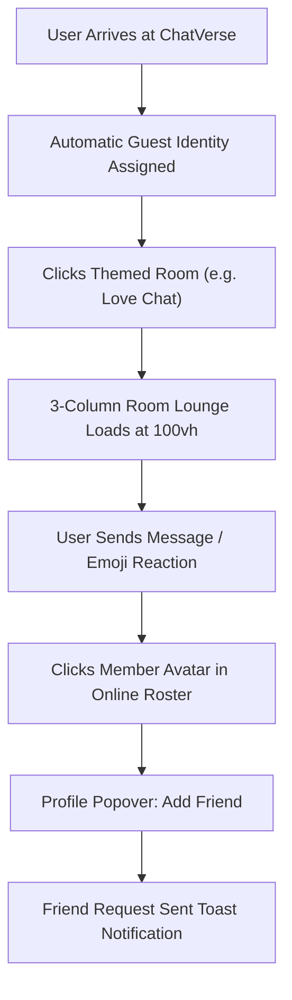
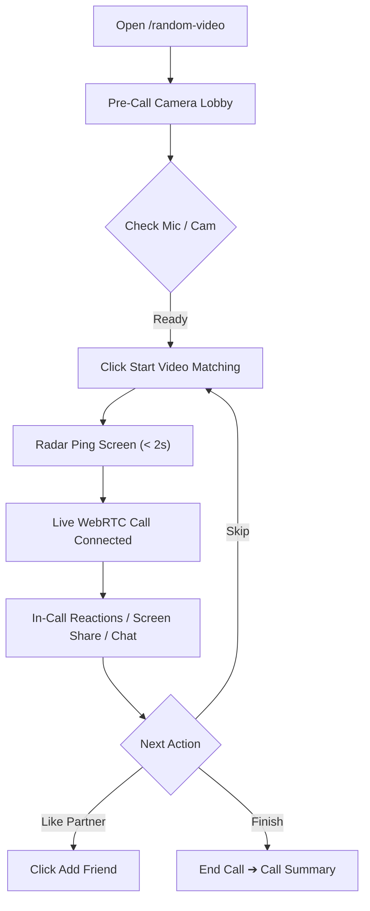
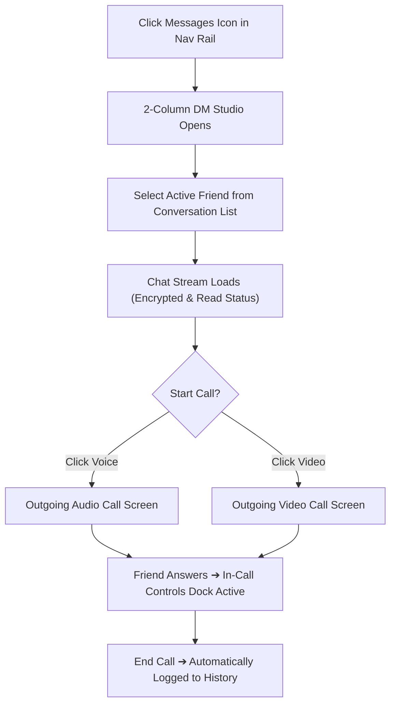

# ChatVerse — UX Brief

## 1. Selected Concept: The Social Lounge (Hybrid App Shell)

A warm, human-centered social platform combining an omnipresent desktop left navigation rail (and fluid mobile bottom bar) with a 100vh 3-column chat lounge, instant WebRTC random matching radar, and direct 1-on-1 private calling.

### Comparison with Rejected Concepts
| Criteria | Concept 1: The Social Lounge (Chosen) | Concept 2: Streamline Matcher (Rejected) | Concept 3: Community Deck (Rejected) |
|---|---|---|---|
| **Time to Value** | Instant (< 3s via auto-guest) | Instant (< 2s) | Moderate (card clicks) |
| **Community Bonding** | High (persistent room lounges) | Low (strangers bounce fast) | High |
| **Multi-tasking Efficiency** | High (persistent rail switching) | Low (single-stream focus) | Low (page reload navigation) |
| **Mobile Ergonomics** | High (bottom bar + drawers) | High | Moderate |
| **Must-Have Coverage** | 100% of Phase 1 requirements | 50% (lacks deep room culture) | 80% (fragmented navigation) |

---

## 2. User Journey Map

| Stage | User Goal | Actions | Thoughts & Feelings | Pain Points Addressed | UX Opportunities |
|---|---|---|---|---|---|
| **1. Landing & First Entry** | Explore what ChatVerse is without hassle | Lands on home, clicks "Love Chat" or "Random Video" | "Hope I don't have to fill a 10-field signup form" | No sign-up wall; instant guest nickname assigned | Live active counter pill builds immediate social proof |
| **2. In-Room Immersion** | Join an active topic discussion | Reads messages, sends text, reacts with emojis | "People here seem friendly and real" | No dead rooms; 3-column layout gives full context | Real-time typing indicators & warm message bubbles |
| **3. Spontaneous Video Match** | Meet someone new face-to-face | Checks camera in lobby, taps "Start Video Match" | "Is my mic working? Who will I meet?" | Live audio meter & camera test eliminate anxiety | Floating reactions (❤️, 🔥) break the ice instantly |
| **4. Friendship Formation** | Keep in touch with a great connection | Taps "Add Friend" from roster or video call dock | "I want to chat with this person again" | Duplicates & blocked users prevented | Instant toast feedback with zero page refresh |
| **5. Habitual Communication** | Reconnect with accepted friends | Sees green presence dot, opens DM, taps "Voice Call" | "Feels like a private, safe space" | Clunky phone numbers eliminated | Direct browser-to-browser HD encrypted calling |

---

## 3. User Flows

### Flow 1: 1-Click Room Chat & Social Connection

### Flow 2: Random Video Call & Friend Conversion

### Flow 3: Direct Messaging & 1-on-1 Calling

---

## 4. Information Architecture & Navigation Model

### Persistent App Shell (Unified Global Chrome)
* **Desktop (Left Persistent Rail):**
  - Brand Icon (ChatVerse)
  - `Home` (`/`)
  - `Rooms` (`/rooms`) — with active room indicators
  - `Random Match` (`/random-video` & `/random-chat`)
  - `Messages` (`/messages`) — with red unread notification badge
  - `Friends` (`/friends`) — with pending requests count
  - Bottom: `User Profile` & `Settings`
* **Mobile (Fluid Bottom Action Bar):**
  - 5 primary touch points: `Home`, `Rooms`, `Match`, `Messages`, `Profile`.
  - Chat room participant lists and in-call chat slide up as bottom sheets / side drawers.

---

## 5. Screen Inventory

| Screen | Type | Primary Action | Content Priority | States |
|---|---|---|---|---|
| **1. Chat Room Studio (`/rooms/[slug]`)** | **HERO SCREEN** | Send message in real-time stream | 1. Active message feed 2. Room switcher rail 3. Online members & media | Empty (new room), Active, Disconnected retry |
| **2. Home Page (`/`)** | Key Screen | Explore Rooms / Instant Match | 1. Hero with live pulse 2. 4 core feature cards 3. Category room grid | Guest vs Logged-in |
| **3. Random Video (`/random-video`)** | Key Screen | Start Video Match | 1. Camera preview & audio meter 2. Live video stream & PIP 3. Control dock | Idle lobby, Searching radar, Connected call, Call ended |
| **4. Direct Messages (`/messages`)** | Key Screen | Send private message / Start call | 1. Conversation list with unread badges 2. Active chat stream 3. Call action buttons | Empty inbox, Active chat, Friend request required |
| **5. Friends Directory (`/friends`)** | Key Screen | Accept request / Start chat | 1. Filter tabs (All, Online, Requests) 2. Friend cards with call triggers | Zero friends, Pending requests, Discover users |
| **6. User Profile (`/profile/[username]`)** | Supporting | Add Friend / Message | 1. Avatar, bio, and role badge 2. Mutual friends & joined rooms | Own profile (edit mode) vs Public view |

---

## 6. Hero Screen Selection: Individual Chat Room Studio (`/rooms/[roomSlug]`)
The Individual Chat Room screen carries the greatest emotional and functional weight. It is where conversations thrive, friendships originate, and users spend 75%+ of their platform time. It defines the warm social atmosphere, typography, message rhythm, and multi-pane responsive behavior for the entire platform.

---

## 7. Product UX Principles
1. **Zero Friction to Conversation:** An auto-guest session is ready from the first second. No modal blocks a user from chatting in a room.
2. **Warmth Over Clinical Clutter:** Soft rounded cards (`rounded-2xl`), gentle pill badges, lively emoji reactions, and human-friendly micro-interactions.
3. **Spatial Peace & Order:** 3 clear columns on desktop; fluid slide-over sheets on mobile. No overlapping chaos.
4. **Immediate Safety:** 1-click user blocking, reporting, and call termination always front and center.
